<p align="center">
  <a href="https://vortexml.ro">
    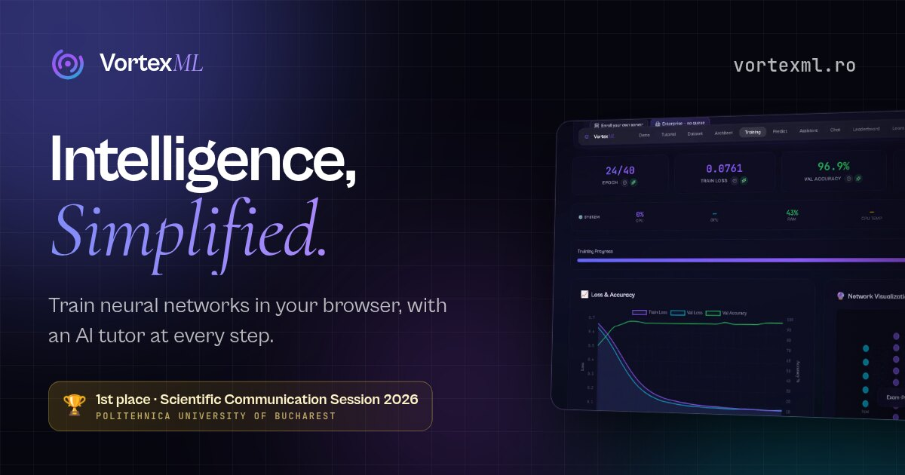
  </a>
</p>

<h1 align="center">VortexML</h1>

<p align="center">
  <strong>Train neural networks in your browser, with an AI tutor at every step.</strong><br>
  Free, no code, no installation.
</p>

<p align="center">
  <a href="https://vortexml.ro"><strong>vortexml.ro</strong></a> ·
  <a href="https://vortexml.ro/demo">Live demo</a> ·
  <a href="https://vortexml.ro/tutorial">Ten-minute tutorial</a> ·
  <a href="DEPLOYMENT.md">Deployment guide</a>
</p>

<p align="center">
  <a href="https://vortexml.ro"></a>
  
  
  
  
  
  <a href="backend/LICENSE"></a>
</p>

---

VortexML is a web platform for building, training and using neural networks on
tabular data. You upload a table, choose the column to predict, let an AI
co-pilot design the network (or set it by hand), watch it train live, and then
ask the trained model for predictions. An AI tutor explains every setting in
plain language along the way.

It is made for students and people meeting machine learning for the first time,
and for anyone who wants to try a model on their own table quickly.

> **1st place, Scientific Communication Session 2026 — Politehnica University of Bucharest**

<p align="center">
  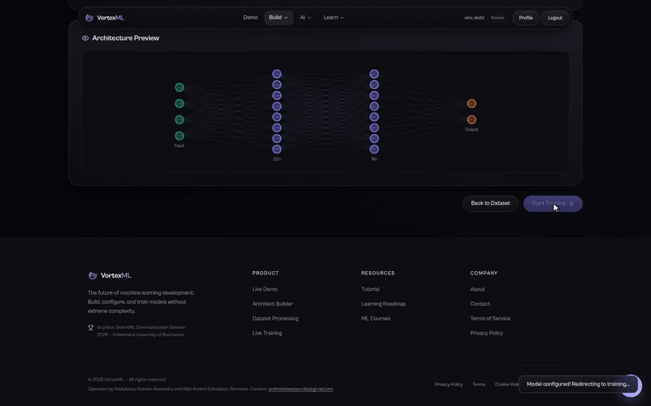
  <br>
  <em>A real training run, recorded from the running app.</em>
</p>

## What you can do

<table>
  <tr>
    <td width="50%" valign="top">
      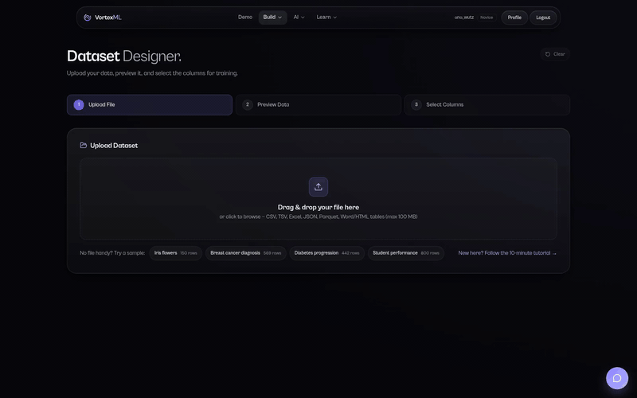
      <h3>Bring a table</h3>
      Upload CSV, TSV, Excel, JSON or Parquet (up to 100 MB), preview it, read
      the health check, and mark the feature columns and the target. Four sample
      datasets load with one click.
    </td>
    <td width="50%" valign="top">
      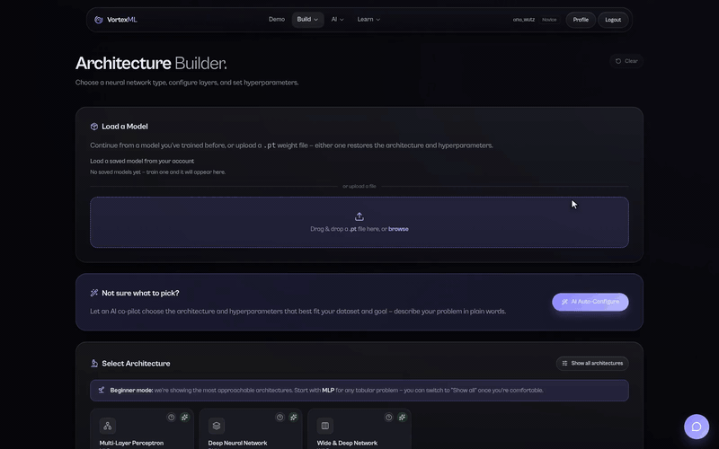
      <h3>Let the AI design the network</h3>
      Describe the goal in plain words. The co-pilot reads a summary of the
      dataset, asks a question or two, and proposes an architecture and
      hyperparameters with its reasoning. One click applies them.
    </td>
  </tr>
  <tr>
    <td valign="top">
      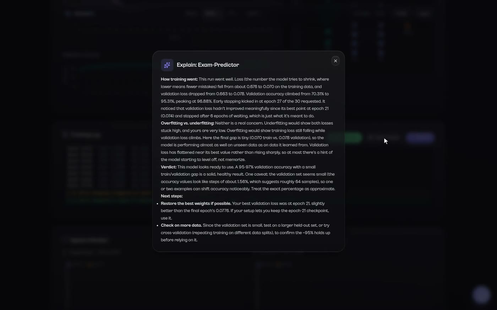
      <h3>Have the result explained</h3>
      When a run finishes, Explain Results reviews it: how training went,
      whether the model is overfitting, whether it is ready, and what to try
      next.
    </td>
    <td valign="top">
      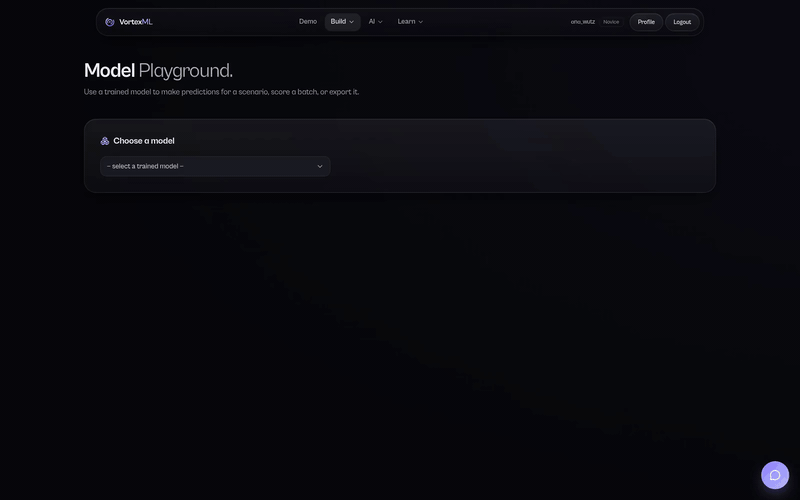
      <h3>Ask the model questions</h3>
      Enter new values, or upload a file of rows, and get predictions with the
      model's confidence. Trained models can be exported as ONNX or TorchScript.
    </td>
  </tr>
  <tr>
    <td valign="top">
      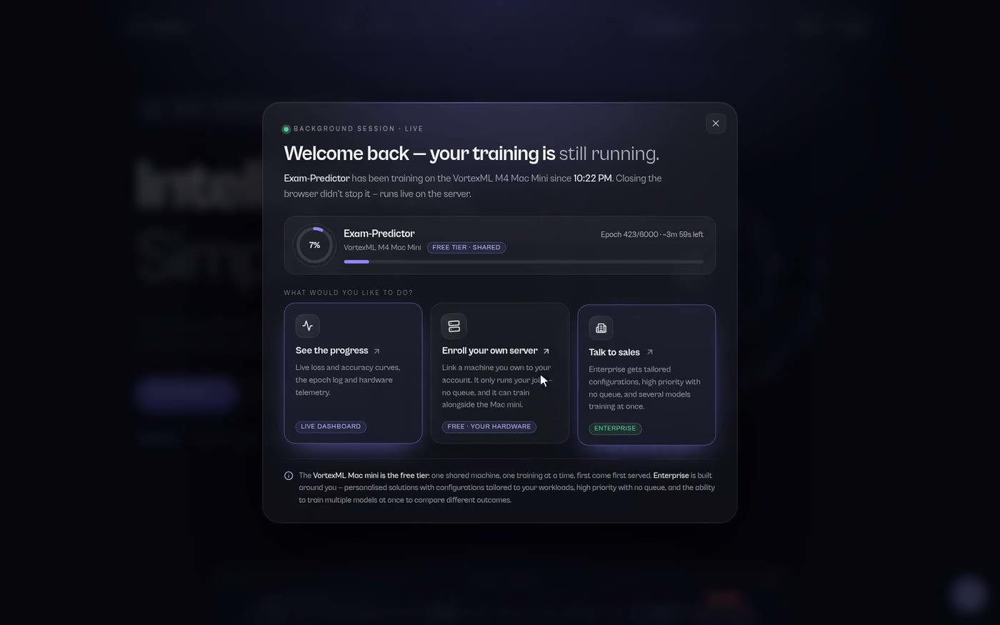
      <h3>Close the tab</h3>
      Training runs on the server, with a queue. A run keeps going when the
      browser is closed, and you can pick it up from any device, or link a
      machine you own and train on that instead.
    </td>
    <td valign="top">
      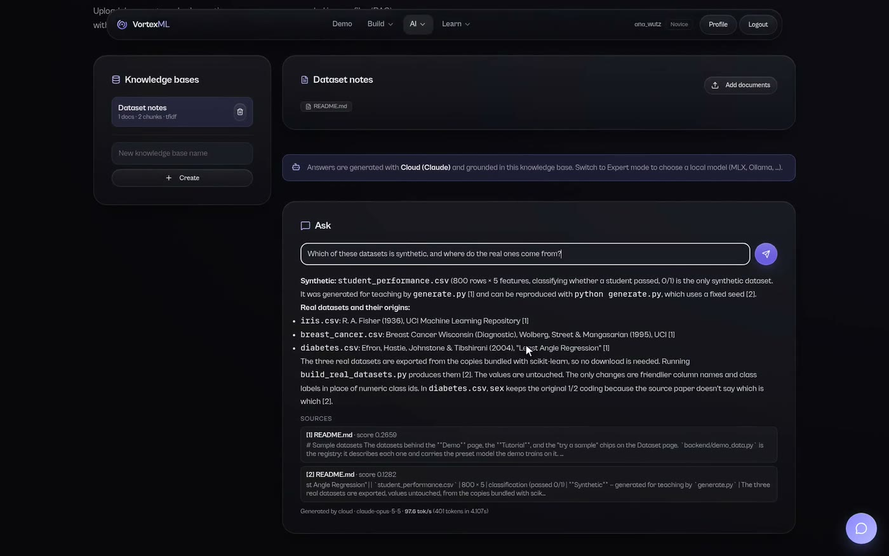
      <h3>Ask your documents</h3>
      The Assistant builds a knowledge base from your files (PDF, Word, Excel,
      PowerPoint, Markdown and more) and answers from them, citing the passages
      it used. Chat is a saved, streaming conversation with a language model.
    </td>
  </tr>
  <tr>
    <td valign="top">
      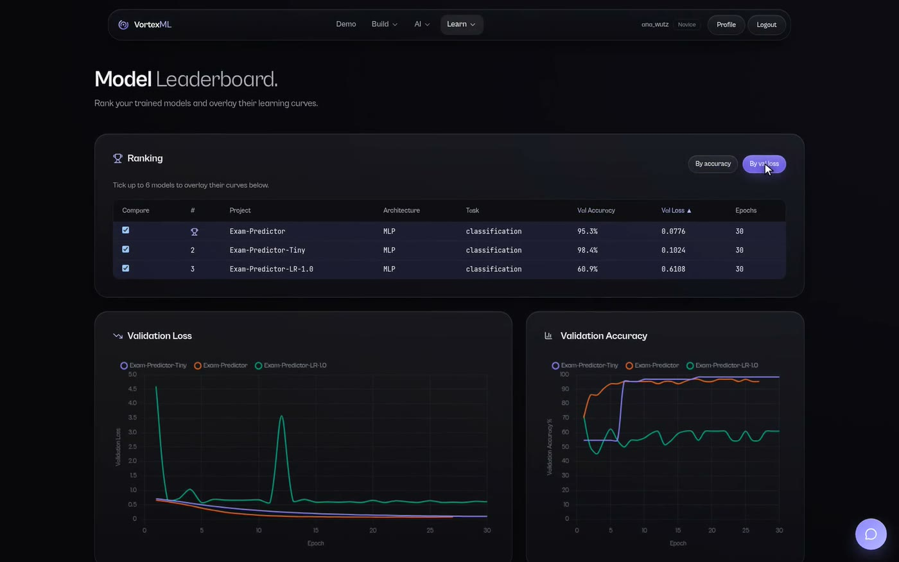
      <h3>Compare your runs</h3>
      The Leaderboard ranks your saved models and overlays their validation
      loss and accuracy curves.
    </td>
    <td valign="top">
      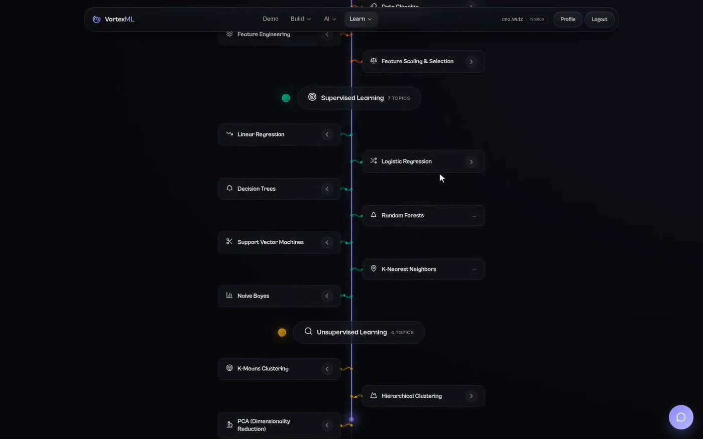
      <h3>Learn the theory</h3>
      A roadmap of eight milestones from mathematics to deployment, and eight
      written courses on neural-network architectures with formulas and PyTorch
      code.
    </td>
  </tr>
</table>

**Ten network types:** Multi-Layer Perceptron, Deep Neural Network, 1D
Convolutional Network, RNN, LSTM, GRU, Autoencoder, Residual Network,
Transformer, and Wide & Deep.

**Two modes.** Three questions at sign-up choose between Novice (the
approachable network types, gentler defaults and the AI tutor) and Expert (all
ten types and extra controls). The mode can be switched at any time.

## Try it

- **[Live demo](https://vortexml.ro/demo)** trains a real model on a bundled
  dataset in one click. No account needed.
- **[Tutorial](https://vortexml.ro/tutorial)** walks through a first model in
  about ten minutes, with a practice dataset and a recording of every step.

The AI features (tutor, co-pilot, Explain Results, Assistant, Chat), saved
models and the Predict page need a free account.

## Run it locally

You need **Python 3** and **Node.js 20.19 or newer**. Everything else is
installed by the start script.

```bash
git clone https://github.com/Scientific-Communication-Session/vortexml.git
cd vortexml
cp .env.example .env      # optional: add ANTHROPIC_API_KEY for the AI features
./start.sh                # builds the site and starts both servers
```

Then open <http://localhost:5173>. `./start.sh --dev` starts the Vite dev server
with hot reload instead of the built site.

The first start takes a few minutes: it creates a virtual environment, installs
PyTorch and the other packages, downloads the Cabinet Grotesk font files from
Fontshare, and builds the frontend.

| Setting in `.env` | What it does |
|---|---|
| `ANTHROPIC_API_KEY` | Enables the AI features. Without it they are switched off and the rest of the app works. |
| `VORTEX_SECRET_KEY` | Signs the session cookie. Required in production; optional for local use. |
| `VORTEX_DATABASE_URL` | A PostgreSQL address. Without it the backend uses a local SQLite file. |

[`.env.example`](.env.example) lists the rest, and
[`DEPLOYMENT.md`](DEPLOYMENT.md) covers running it as a public server.

## How it is built

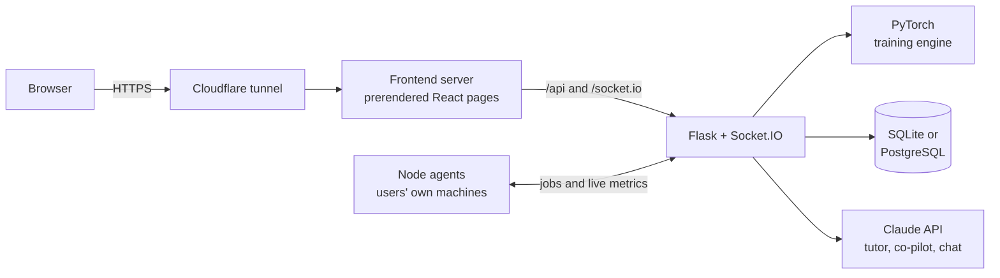

| Part | Made with |
|---|---|
| Frontend | React 19, TypeScript, Vite, Tailwind CSS, Chart.js, Framer Motion |
| Backend | Python, Flask, Flask-SocketIO on eventlet, SQLAlchemy |
| Training | PyTorch, with pandas and scikit-learn for the data |
| AI features | Anthropic's Claude models; the newest Opus and Sonnet are picked automatically |
| Live updates | Socket.IO, from the training loop to the browser |
| Hosting | One Mac mini behind a Cloudflare tunnel |

Training runs in the server process on the shared machine, one run at a time
with a queue. A user can link their own machine instead: a small agent on it
connects out to the server, takes that user's jobs, and streams progress back,
so the browser shows the same live charts either way.

Every public page is written out as static HTML when the site is built, and is
also served as Markdown (`/tutorial.md`, or any page with
`Accept: text/markdown`), so search engines, language models and browser agents
can read the site without running JavaScript. See
[`llms.txt`](https://vortexml.ro/llms.txt).

## What is where

```
backend/                Flask server, training engine, AI features, tests
  app.py                routes, sockets, sessions, the job queue
  training_engine.py    the ten network types and the training loop
  claude_models.py      which Claude models are used, and the one place they are called
  rag.py                the Assistant and Chat
  courses/              the lessons, as Markdown
  node_bundle/          the agent a user runs on their own machine
frontend/               the React site
  src/pages/            one file per page
  scripts/              build steps: prerendering, fonts, IndexNow
  e2e/                  Playwright checks
sample-data/            the four bundled datasets and how they were made
tools/                  the tutorial recorder and the preview-image generator
deploy/                 installing the server as a service on macOS
start.sh                one command to set up and run everything
DEPLOYMENT.md           running it in production
```

## Tests

```bash
# Backend: offline, on a throwaway database
cd backend
venv/bin/python test_smoke.py        # also: test_authz, test_sessions, test_account,
                                     # test_hardening, test_auto_config_rules

# The site as crawlers and browser agents see it (needs the app running)
cd frontend
npm run test:agents
```

The Playwright checks read the site three ways: as a crawler over plain HTTP, as
a browser with JavaScript off, and as an agent that works only through roles and
names. The last one signs up, trains a model, gets a prediction and deletes the
account. [`DEPLOYMENT.md`](DEPLOYMENT.md) describes them and the conventions
that keep them passing.

## Documentation

- [`DEPLOYMENT.md`](DEPLOYMENT.md): the production setup, the tunnel, training on
  your own device, background sessions and the queue, and what the backend
  relies on
- [`sample-data/README.md`](sample-data/README.md): where the bundled datasets
  come from
- [`.env.example`](.env.example): every configuration setting

## Team

VortexML is built and run by **Niță Andrei-Sebastian** and
**Rădulescu Răzvan-Alexandru**, in Romania.

Questions, feedback or a bug to report:
[andreisebastian.nita@gmail.com](mailto:andreisebastian.nita@gmail.com), or the
contact form in the site's footer.

## Licence

The source is published for reading and for personal, non-commercial use. It is
not open source: redistribution, modification, public deployment and commercial
use need written permission from both authors. The full terms are in
[`backend/LICENSE`](backend/LICENSE).

Copyright © 2026 Andrei-Sebastian Niță and Răzvan-Alexandru Rădulescu.
